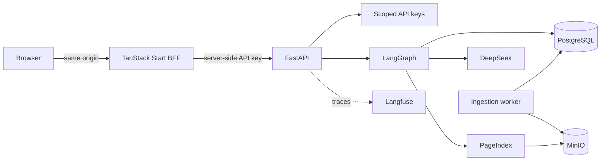

<!-- Content type: Landing -->
<!-- Content plan: Goal: help researchers decide whether to run Vectorless RAG and reach the first cited answer. Audience: researchers, operators, and contributors. Content: status, use cases, architecture, costs, startup, testing, and project links. Open questions: measured vector-versus-PageIndex answer quality at full-corpus scale. -->

# Vectorless RAG

[](https://github.com/ProofOfTechOrg/vectorless-rag/actions/workflows/ci.yml)
[](LICENSE)
[](https://github.com/ProofOfTechOrg/vectorless-rag/releases)

Vectorless RAG is a self-hosted research preview for grounded question answering over local Portable Document Format (PDF) files. It uses PageIndex hierarchies instead of embeddings or a vector database, then returns inline citations that resolve to document pages.

Version 0.2.0 is a prerelease. It supports evaluation and bounded pilots, not production stability or unattended full-corpus ingestion.

## Choose this project for bounded research

Vectorless RAG fits these use cases:

- Compare hierarchical, vectorless retrieval with a conventional vector retrieval-augmented generation (RAG) system
- Ask cross-document questions over a small, controlled PDF corpus
- Inspect retrieval routes, durable ingestion jobs, citations, token use, and provider costs
- Run a self-hosted browser console with scoped API keys and server-side credential storage

Do not use this preview for regulated workloads, scanned PDFs that require optical character recognition (OCR), or an unreviewed full-corpus migration.

## Understand costs and limits before starting

Ingestion and live chat call DeepSeek and can incur provider charges. The default safety controls cap registration at 25 documents, keep full-corpus indexing disabled, and enforce a $10 frozen-pilot ceiling. Provider prices can change, so check the [official DeepSeek model and pricing reference](https://api-docs.deepseek.com/quick_start/pricing/) before a paid run.

The configured `deepseek-v4-pro` model remains available in that reference. Deterministic unit, integration, deployment, and browser tests do not require provider credentials.

Current limitations include:

- Born-digital PDFs only, with no OCR
- No API-key lifecycle interface or embedded PDF viewer
- Source builds only, with no package-registry or container-registry release
- A pilot gate instead of a production-scale claim
- No final vector-versus-PageIndex quality verdict

## Follow the request path

The browser-facing frontend (BFF) keeps API keys out of browser-readable storage. FastAPI authorizes each API request, LangGraph coordinates retrieval, and a durable worker builds PageIndex artifacts.



Docker Compose runs the console, API, worker, PostgreSQL, MinIO, Langfuse, ClickHouse, and Redis. The Helm chart exposes the same application boundaries for Kubernetes.

## Start with one PDF

You need Docker Compose 2.22 or later, GNU Make, Python 3.12, and `uv`. Run these commands from the repository root:

```bash
make init
# Add DEEPSEEK_API_KEY to .env.
make up
make bootstrap-key NAME=browser-operator
```

Save the one-time `vrag_…` key. Open [the local operator console](http://localhost:3001/connect), enter the key, and upload one born-digital PDF from **Ingestion**. Ask a question from **Chat** after ingestion succeeds.

The stack stores service data in named volumes. Stop containers without deleting data:

```bash
make down
```

Read [get started with one cited answer](docs/getting-started.md) for prerequisites, expected states, and cleanup.

## Run provider-free verification

Install the frozen development dependencies before running the complete local gates:

```bash
make install
make docs-check
make api-check
make test-integration-stack
make web-check
make playwright
make deploy-check ENV_FILE=.env.example
make docker-build
```

`make playwright` uses the existing mock upstream only for deterministic browser coverage. It is not a product demo and does not replace the paid release gate.

Read [choose a test tier](docs/testing.md) for test prerequisites and provider boundaries.

## Find the next task

The [documentation index](docs/README.md) routes setup, operation, deployment, security, evaluation, and historical design work. Start with:

- [Contributing](CONTRIBUTING.md) for development and pull requests
- [Security policy](SECURITY.md) for private vulnerability reports
- [Support](SUPPORT.md) for questions and reproducible defects
- [Changelog](CHANGELOG.md) for release status and limitations
- [MIT License](LICENSE) and [third-party notices](THIRD_PARTY_NOTICES.md) for redistribution terms
