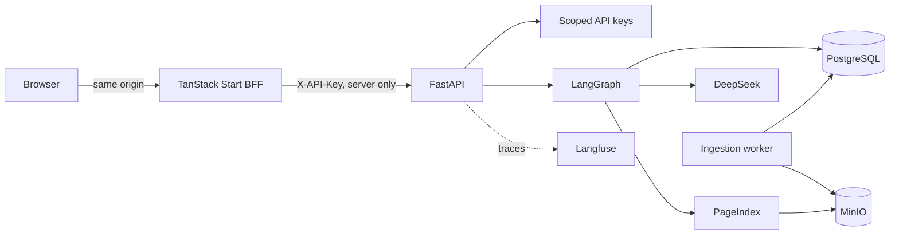

<!-- Content type: Landing -->

# Vectorless RAG

A self-hosted research application for asking grounded questions across a local PDF corpus without embeddings or a vector database. The browser-first Vectorless RAG Operator Console uses ASTRYX and TanStack Start. Its server-side BFF stores the API key in an encrypted HttpOnly cookie and calls FastAPI.

PostgreSQL narrows the corpus, DeepSeek selects papers, and PageIndex retrieves structure-aware page evidence. Responses include resolvable citations.

## Quick start

Requirements: Docker Compose 2.22 or later and GNU Make. Local package development also uses Python 3.12, `uv`, Node 22, and pnpm. Helm 3 is required only to validate or deploy the Kubernetes chart.

Run `make download-corpus` before `make up` if you want the full test corpus. The download is optional and requires Bash, `curl`, and approximately 1.5 GB of free space.

```bash
make env
make secret-api-pepper
make secret-session
make secrets-langfuse
# Edit .env: replace change-me values and set DEEPSEEK_API_KEY.
make up
make bootstrap-key NAME=browser-operator
```

Save the one-time `vrag_…` key, open [http://localhost:3001](http://localhost:3001), and enter it on `/connect`. Langfuse remains on port 3000 and FastAPI/OpenAPI on [http://localhost:8000/docs](http://localhost:8000/docs).

The key is validated by FastAPI, encrypted with AES-256-GCM, and stored for eight hours in an HttpOnly, `SameSite=Lax`, `Path=/` cookie. Production uses `Secure` and a `__Host-` name. It is never placed in browser storage, a URL, an SSR payload, or a browser-readable cookie.

## Download the test corpus

The repository tracks the 537 arXiv IDs used for corpus testing, but it does not distribute the PDFs. This command downloads missing PDFs directly from arXiv into `arxiv-pdfs`:

```bash
make download-corpus
```

Set `ARXIV_PDF_HOST_DIR` when your Compose corpus mount uses another host directory:

```bash
make download-corpus ARXIV_PDF_HOST_DIR=/srv/vectorless/arxiv-pdfs
```

The command validates each response before installing it as `arxiv_id.pdf`. Reruns skip valid existing PDFs without network requests, while invalid existing paths remain untouched and cause a nonzero exit status.

Downloading only creates local files. It does not start the stack or queue ingestion. After the stack is running, `make sync-corpus` queues the mounted files under the existing ten-document pilot gate. See the [command reference](docs/commands.md#download-the-test-corpus) for failure handling and request-rate details.

## Architecture



Browser requests never call FastAPI directly. TanStack server functions and routes authorize at their own boundary, validate runtime responses, enforce the configured full `APP_ORIGIN` on mutations, and clear a rejected session after an upstream `401`. Chat SSE is proxied without re-buffering and propagates cancellation.

## Console

- `/connect`: API-key validation, safe errors, and bootstrap help.
- `/chat` and `/chat/$threadId`: recent threads, route/progress states, Markdown, citations, cancel, retry, and feedback.
- `/documents` and `/documents/$documentId`: cursor pagination, responsive table/list views, metadata, topics, status, diagnostics, and citation landing pages.
- `/ingestion`: PDF upload, durable job polling, mounted-corpus sync, force confirmation, and pilot warnings.
- `/settings`: key identity/scopes, readiness, system/light/dark appearance, setup details, and logout.

The UI hides or disables actions outside the key's scopes, while FastAPI remains the authorization boundary.

## Repository layout

```text
apps/api/                   Python package, tests, Alembic, evaluation, scripts, image
apps/web/                   TanStack Start app, Vitest, Playwright, Node image
infra/docker/postgres-init/ PostgreSQL first-start initialization
infra/helm/vectorless-rag/ Full-stack Helm chart
docs/                       Security, deployment, operator, command, evaluation, backup docs
compose.yaml                Local full stack
Makefile                    Repository command surface
arxiv-pdfs/                 Git-ignored, user-owned local corpus
```

## Development and verification

```bash
make dev              # full Compose stack with API, worker, and web reload
make dev-health       # verify the web service is running through Vite
make dev-build        # optional development image prebuild/troubleshooting
make web-dev          # host web on :3001 against the Compose API on :8000
make install          # install host API and web dependencies
make api-check
make web-check
make deploy-check ENV_FILE=.env.example
make playwright-install # install Chromium and its operating-system dependencies
make playwright       # deterministic mock-upstream browser suite
make docker-build
make ci               # local CI equivalent
```

Use `make help` or the [command reference](docs/commands.md) for every target. Follow the [live verification workflow](docs/operator-guide.md#verify-a-disposable-live-stack) before running `make playwright-live`.

`make dev` is the canonical active-development command. It runs in the foreground, builds the current images, and mounts local API and web source into the containers. Web source edits update through Vite hot module replacement. Changes to `apps/web/package.json`, either workspace manifest, `pnpm-lock.yaml`, or `apps/web/Dockerfile` automatically rebuild and recreate the web service. `make dev-build` remains available as an optional image prebuild or troubleshooting command. Docker Compose 2.22 or later is required for these watch rules.

Changes to `.env`, `compose.yaml`, or `compose.dev.yaml` require stopping `make dev` with Ctrl+C and rerunning it so Compose can resolve the updated service configuration.

`make up` starts an immutable deployment-style stack in the background and does not hot-reload or force image rebuilds. Run `make rebuild` to rebuild and recreate the complete stack. `make restart-app` rebuilds only API and worker, while `make restart-web` rebuilds only the production-style frontend. These commands preserve named volumes.

## Ingestion safety

The default ten-document pilot gate remains enabled. Upload born-digital PDFs through the UI or use `make sync-corpus`; OCR and recursive/arbitrary server paths are out of scope. Do not sync a large mounted corpus until you intend to queue the pilot. See the [operator guide](docs/operator-guide.md).

## Advanced API client path

All `/v1` routes use `X-API-Key`; `/health/live` and `/health/ready` are public.

```bash
export VECTORLESS_RAG_ADMIN_KEY=vrag_replace_me
curl --fail --silent --show-error http://localhost:8000/v1/auth/me \
  -H "X-API-Key: $VECTORLESS_RAG_ADMIN_KEY"
curl --fail --silent --show-error -X POST http://localhost:8000/v1/chat \
  -H "X-API-Key: $VECTORLESS_RAG_ADMIN_KEY" \
  -H 'Content-Type: application/json' \
  -d '{"message":"Compare retrieval quality in the indexed papers.","constraints":{}}'
```

`GET /v1/auth/me` returns only key name and scopes. `GET /v1/threads?limit=&cursor=` returns key-isolated recent threads ordered by activity. OpenAPI documents the complete surface.

## Deployment

`compose.yaml` runs web (3001), Langfuse (3000), API (8000), worker, PostgreSQL, ClickHouse, Redis, and MinIO while preserving the existing named volumes. The chart in `infra/helm/vectorless-rag` has separate API and optional frontend ingresses, services, probes, resources, and secret wiring. Read [deployment](docs/deployment.md) and [security](docs/security.md) before exposing the application.
