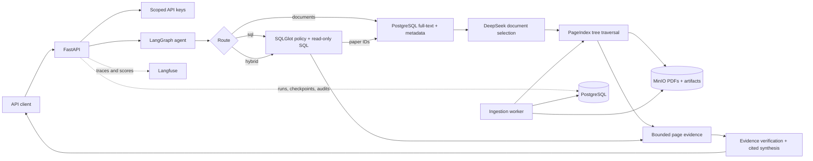

# Vectorless ArXiv RAG

A self-hosted, API-only research agent for asking grounded questions across a local PDF corpus—without embeddings or a vector database.

The service was built for a local corpus of 537 ArXiv papers and includes the infrastructure needed to ingest, search, reason over, and cite them. The PDFs themselves are intentionally Git-ignored and are not distributed with the repository; bring your own born-digital PDFs through the local corpus mount or upload API. PostgreSQL performs deterministic metadata and full-text filtering, DeepSeek selects the most relevant papers, and [PageIndex](https://github.com/VectifyAI/PageIndex) traverses each paper's hierarchical structure to retrieve evidence. LangGraph coordinates document retrieval, guarded Text-to-SQL, hybrid questions, citation validation, and conversational state.

Everything except the hosted DeepSeek model runs locally through Docker Compose or on Kubernetes through the included Helm chart.

## Why this exists

Conventional RAG usually chunks documents, embeds every chunk, and retrieves by vector similarity. That is useful for many corpora, but it introduces another index and retrieval model while often losing the document structure that matters in long technical papers.

Vectorless ArXiv RAG takes a different approach:

- **No embedding pipeline or vector database.** PostgreSQL narrows the corpus using explicit metadata and native full-text search.
- **Structure-aware retrieval.** PageIndex builds a table-of-contents-like tree for each PDF. The model reasons over that tree before reading tight page ranges.
- **Auditable answers.** Substantive document claims must resolve to an indexed paper and page range; SQL-backed answers expose an audit ID.
- **One agent for content and catalog questions.** The graph routes requests to document retrieval, guarded SQL, or a hybrid path that uses SQL to select papers before reading them.
- **Local corpus ownership.** Original PDFs and normalized PageIndex artifacts live in S3-compatible object storage under your control.

This design is especially useful when document hierarchy, exact page provenance, operational control, and a modest-to-medium corpus matter more than low-latency approximate-nearest-neighbor retrieval. The tradeoff is that reasoning-based selection uses hosted-model calls and can be slower or more expensive per query than vector lookup.

## What the service solves

| Complexity | Implementation |
| --- | --- |
| Finding the right papers without vectors | Metadata constraints and PostgreSQL full-text search select up to 50 candidates; DeepSeek reranks at most eight. |
| Finding evidence inside long PDFs | PageIndex trees guide node selection, bounded page reads, and a second retrieval round when evidence is insufficient. |
| Preventing retrieval from growing without bound | A request is capped at eight documents, four page ranges per document, 24 pages, and 40,000 evidence tokens. |
| Keeping answers grounded | Evidence is normalized, every emitted document citation includes a page range, and unresolved citations cause an explicit refusal. |
| Answering aggregate/catalog questions safely | SQLGlot restricts generated SQL to read-only queries over two curated views, with row, timeout, payload, lock, and `EXPLAIN` cost limits. |
| Resumable parallel ingestion | PostgreSQL jobs are claimed with `FOR UPDATE SKIP LOCKED`; isolated PageIndex workspaces prevent concurrent `_meta.json` corruption. |
| Reprocessing and deduplication | PDFs are keyed by SHA-256 and index versions include the PDF checksum, PageIndex revision, prompt version, and model. |
| Operating a hosted model without exporting the platform | PostgreSQL, MinIO, Langfuse, ClickHouse, and Redis remain self-hosted; only DeepSeek is external. |
| Tracing without making observability the security record | Langfuse receives masked diagnostic traces while PostgreSQL retains authoritative SQL and retrieval audits. |
| Safely rolling out a real corpus | Full-corpus ingestion is disabled until a ten-document quality and projected-cost pilot is reviewed. |

## Architecture



The top-level graph follows:

1. Normalize the request and structured metadata constraints.
2. Route to `documents`, `sql`, `hybrid`, or `clarify`.
3. Run the selected specialist path. Hybrid requests use SQL results to constrain document retrieval.
4. Verify evidence sufficiency and retry document traversal once when needed.
5. Synthesize only from retrieved evidence and return resolvable citations or an explicit insufficiency response.

PDF text is always treated as untrusted content, never as instructions.

## Questions this system is designed to answer

The exact answers depend on the PDFs you provide, but the service is built for questions that require more than finding a paragraph with similar wording:

| Example question | Route | Why it is difficult |
| --- | --- | --- |
| “Across the indexed papers published from 2023 through 2025, compare how retrieval faithfulness is defined and measured. Where do the reported metrics disagree? Cite every definition and result by page.” | Documents | It must identify several relevant papers, follow their internal structure, reconcile different terminology, and preserve page-level provenance for each comparison. |
| “Which papers by a given author or on a given topic were submitted after 2024, and which of those report methods that avoid embeddings? Compare their stated accuracy, latency, and cost tradeoffs.” | Hybrid | SQL applies exact catalog constraints first; PageIndex then reads the selected papers to answer the substantive methodological part. |
| “Reconstruct the experimental setup, baselines, ablations, main findings, and limitations of this paper. Clearly separate author claims from measured results.” | Documents | The evidence is usually scattered across methods, results, appendices, and limitations rather than contained in one chunk. |
| “Which indexed papers evaluate on HotpotQA, and how do their retrieval strategies, evaluation protocols, and reported failure modes differ?” | Hybrid | Dataset mentions help identify candidate papers, but a defensible comparison requires reading multiple sections across multiple documents. |
| “Paper A claims an improvement over Paper B. Are the results actually comparable given their datasets, baseline definitions, metrics, and experimental settings?” | Documents | It requires cross-paper reasoning and must avoid treating differently defined numbers as directly comparable. |
| “How many documents are ready, failed, or unsupported, and when was each status most recently updated?” | SQL | The answer is an aggregate over the curated ingestion-summary view, not a semantic PDF search, and includes a query audit ID. |
| “What did private peer reviewers say about these papers?” | Refusal | Private reviews are not present in the supplied corpus, so the grounded response is an explicit insufficiency result rather than a plausible-sounding answer. |

These examples are deliberately multi-step. The agent can combine exact metadata filtering, catalog aggregation, structure-aware page retrieval, evidence sufficiency checks, and cited synthesis in one request. It is not a general web-search system: claims must be supported by the indexed corpus or the curated catalog views.

## Included components

- FastAPI with JSON, SSE streaming, health, document, ingestion, thread, and feedback APIs
- LangGraph with PostgreSQL-backed thread checkpoints
- DeepSeek V4 Pro through `ChatDeepSeek` and LiteLLM
- PageIndex OSS pinned to revision `190f8b378be58199ca993566a9214dba72089c54`
- PostgreSQL for application state, full-text search, jobs, curated SQL views, and audits
- MinIO for canonical PDFs and normalized, versioned PageIndex artifacts
- Self-hosted Langfuse with ClickHouse, Redis, and S3-compatible storage
- Alembic migrations, Pydantic contracts, SQLAlchemy/psycopg, and SQLGlot SQL policies
- Docker Compose for a single host and an umbrella Helm chart for Kubernetes
- Ruff, strict whole-repository Basedpyright, pytest, Docker, migration, Compose, and Helm checks in GitHub Actions

## Quick start

### Prerequisites

- Docker with Docker Compose v2
- GNU Make
- A hosted DeepSeek API key
- `uv` and Helm 3 only when running development or chart checks locally

### 1. Configure the environment

```bash
make env
make secret-api-pepper
make secrets-langfuse
```

`make env` creates `.env` only when it does not already exist and restricts it to mode `0600`; it never overwrites an existing file. Edit `.env`, replace every `change-me` value, set `DEEPSEEK_API_KEY`, and paste the generated API pepper and Langfuse values into their matching fields.

The supplied Compose configuration deliberately has no environment-variable fallbacks: `.env` is the single source of truth. The [deployment guide](docs/deployment.md#local-and-production-requirements) identifies which fields are mandatory locally and in production, and explains first-time Langfuse initialization.

### 2. Start the platform

```bash
make up
make health
```

The API and ingestion worker run separately. The API applies migrations at startup; the worker claims durable PostgreSQL jobs and can resume after a restart.

### 3. Create an operator key

```bash
make bootstrap-key NAME=operator
```

This creates a high-entropy key with `chat`, `documents:read`, and `admin:ingest` scopes. PostgreSQL stores only its prefix and an HMAC-SHA256 hash. Save the printed `vrag_...` value—it is shown once—and export it for operator commands:

```bash
export VECTORLESS_RAG_ADMIN_KEY=vrag_replace_me
```

### 4. Queue the ingestion pilot

```bash
make sync-corpus
make pilot-report
```

Ingestion is asynchronous. Use `make logs SERVICE=worker` in another terminal to follow indexing,
and run the pilot report after the queued jobs reach a terminal state.

The default corpus directory is `./arxiv-pdfs`, which is excluded by `.gitignore`. Create it and add your PDFs, or change `ARXIV_PDF_HOST_DIR` in `.env` to mount an existing host directory. The service does not watch that directory: after adding or replacing PDFs, run `make sync-corpus` again. Files are deduplicated by content, and removing a source file does not delete its stored document or index.

Only ten previously unknown PDFs can be registered while `ALLOW_FULL_CORPUS_INDEX=false`. Review extraction quality, failures, elapsed time, token usage, retrieval/citation quality, and projected DeepSeek cost before enabling the remaining corpus. See the [operator guide](docs/operator-guide.md#pilot-gate) for the approval workflow.

### 5. Ask a question

OpenAPI documentation is available at [http://localhost:8000/docs](http://localhost:8000/docs) and Langfuse at [http://localhost:3000](http://localhost:3000).

```bash
curl --fail --silent --show-error \
  -X POST http://localhost:8000/v1/chat \
  -H "X-API-Key: $VECTORLESS_RAG_ADMIN_KEY" \
  -H "Content-Type: application/json" \
  -d '{
    "message": "Compare how the indexed papers evaluate retrieval quality.",
    "constraints": {}
  }'
```

A completed response contains the answer, selected route, thread and trace IDs, page-level citations, an optional SQL audit ID, and an `insufficient` flag. `POST /v1/chat/stream` exposes the same run through server-sent events.

## API surface

All `/v1` routes require a scoped key in `X-API-Key`.

| Method and path | Scope | Purpose |
| --- | --- | --- |
| `POST /v1/chat` | `chat` | Return a completed routed and cited answer. |
| `POST /v1/chat/stream` | `chat` | Stream run, route, retrieval, answer, citation, completion, and error events over SSE. |
| `GET /v1/threads/{thread_id}` | `chat` | Return history owned by the calling API key. |
| `GET /v1/documents` | `documents:read` | Page through document metadata and index status. |
| `GET /v1/documents/{id}` | `documents:read` | Inspect one document. |
| `POST /v1/admin/documents` | `admin:ingest` | Upload and queue one born-digital PDF, up to 200 MB. |
| `POST /v1/admin/ingestion/sync` | `admin:ingest` | Scan the fixed mounted directory and queue new or forced work. |
| `GET /v1/admin/ingestion/{job_id}` | `admin:ingest` | Inspect job status, diagnostics, attempts, and metrics. |
| `POST /v1/runs/{trace_id}/feedback` | `chat` | Record positive or negative feedback with an optional comment. |

The service also exposes unauthenticated `/health/live` and `/health/ready` probes.

## Safety and operational boundaries

- **Born-digital PDFs only.** Empty or extraction-poor PDFs are marked `unsupported`; OCR is intentionally outside v1.
- **Fixed import root.** Directory sync reads direct `.pdf` children from the configured mount and never accepts arbitrary server paths.
- **Prompt-injection boundaries.** Extracted PDF content is delimited as untrusted throughout metadata extraction, retrieval, verification, and synthesis.
- **Guarded SQL.** Only a single comment-free PostgreSQL `SELECT`/CTE over `agent.paper_catalog_v1` or `agent.ingestion_summary_v1` is accepted. Execution uses a dedicated read-only role and is always rolled back.
- **Bounded execution.** SQL is capped at 200 rows, a 5-second statement timeout, a 1-second lock timeout, 100 KB of result data, and a configurable default `EXPLAIN` cost ceiling of 100,000.
- **Bounded requests.** Chat runs have a 120-second deadline, and SSE disconnects propagate cancellation.
- **Scoped credentials.** API keys have explicit scopes; database roles and Langfuse data are separated; secrets and model reasoning content are masked from traces.
- **Auditable failure.** When evidence or citations are not sufficient, the API refuses to manufacture a grounded answer and sets `insufficient=true`.

Read the complete [security model](docs/security.md) before exposing the service outside an isolated development host.

## Deployment

### Docker Compose

`compose.yaml` runs the API, ingestion worker, PostgreSQL, Langfuse web and worker, ClickHouse, Redis, and MinIO with persistent volumes and health checks.

```bash
make up
make ps
make logs SERVICE=api
make restart-app
make restart-langfuse
make down
```

### Kubernetes

The chart at `deploy/helm/vectorless-rag` includes API and worker deployments, probes, ingress settings, resource controls, persistent storage, and secret references. PostgreSQL, ClickHouse, Redis, and S3-compatible storage can each be bundled or external.

```bash
make helm-check
helm upgrade --install vectorless-rag deploy/helm/vectorless-rag \
  --namespace vectorless-rag \
  --create-namespace
```

Bundled chart dependencies are single-replica and intended for modest installations, not high availability. Review the [deployment guide](docs/deployment.md) for the required Secret keys, PVC configuration, production values, and credential lifecycle.

## Development and verification

The project targets Python 3.12 and uses a frozen `uv.lock`.

```bash
make install
make format
make lint
make typecheck
make test
make check
```

`make typecheck` runs strict Basedpyright analysis over every repository-owned Python file; Pydantic separately validates settings, requests, structured model output, and responses at runtime. `make ci` reproduces the full GitHub Actions validation locally, including the production image build:

```bash
make ci
```

The CI workflow runs Ruff lint/format checks, strict whole-repository Basedpyright, pytest with coverage, workflow parsing, offline Alembic rendering, Compose validation, Helm lint/template, and a Docker build. See the [command reference](docs/commands.md) for all lifecycle, operator, evaluation, and secret-generation targets.

## Repository layout

```text
src/vectorless_rag/          API, graph, retrieval, ingestion, SQL guard, auth, storage
alembic/                     PostgreSQL schema and curated catalog views
deploy/helm/vectorless-rag/  Kubernetes umbrella chart
tests/                       Unit and infrastructure-backed integration tests
evaluation/                  85-case release evaluation dataset
scripts/                     Dataset build and Langfuse seed utilities
docs/                        Deployment, operations, security, evaluation, backup/restore
arxiv-pdfs/                  Git-ignored local PDF corpus mount (user supplied)
compose.yaml                 Complete single-host platform
Makefile                     Canonical development and operator command interface
```

## Evaluation and rollout

The checked-in evaluation dataset contains 85 cases covering single-document, cross-document, SQL, hybrid, unanswerable, and adversarial requests. The documented release gates require all SQL safety tests to pass, every citation to resolve, route accuracy of at least 90%, SQL answer accuracy of at least 95%, pilot citation validity of at least 90%, and no unsupported claims in unanswerable cases.

Full-corpus indexing is deliberately a manual decision. Run the ten-paper pilot, record current DeepSeek rates for cost projection, inspect its report and evaluation results, then explicitly set `ALLOW_FULL_CORPUS_INDEX=true` only after approval.

## v1 scope

Included: local and uploaded born-digital PDFs, vectorless document retrieval, curated PostgreSQL Text-to-SQL, hybrid routing, API-key authentication, durable threads/jobs, tracing, Compose, and Helm.

Not included: embeddings, a vector database, OCR, a browser UI, a CLI chat client, arbitrary filesystem imports, external SQL data sources, PageIndex cloud/enterprise, or LangSmith.

## Documentation

- [Command reference](docs/commands.md)
- [Deployment guide](docs/deployment.md)
- [Operator guide](docs/operator-guide.md)
- [Security model](docs/security.md)
- [Evaluation and release gates](docs/evaluation.md)
- [Backup and restore](docs/backup-restore.md)
