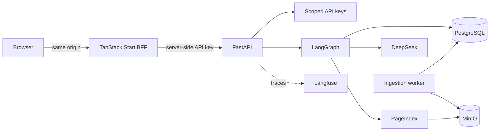

<!-- Content type: Landing -->
<!-- Content plan: Goal: help researchers decide whether to run Vectorless RAG and reach the first cited answer. Audience: researchers, operators, and contributors. Content: release and research status, fit, architecture, costs, startup, verification, and project links. Open questions: measured vector-versus-PageIndex answer quality at full-corpus scale. -->

# Vectorless RAG

[](https://github.com/ProofOfTechOrg/vectorless-rag/actions/workflows/ci.yml)
[](LICENSE)
[](https://github.com/ProofOfTechOrg/vectorless-rag/releases)

Vectorless RAG is a self-hosted research preview for grounded question answering across local PDFs. It builds PageIndex hierarchies without embeddings or a vector database and returns inline citations tied to document pages.

Version 0.2.0 is a prerelease. It supports evaluation and bounded pilots, not production stability or unattended full-corpus ingestion.

## Current research status

The PageIndex v2 evaluation is complete: 1,080 trials produced 1,018 included scores and 62 excluded terminal failures. Free routing selected the required document path in only 18.8% to 31.7% of trials, while larger evidence budgets did not produce a consistent end-to-end quality gain. The experiment therefore does not justify increasing the evidence budget.

The routing, structured-constraint, generated-SQL, hybrid-evidence, retry, and accounting defects exposed during the run are fixed and covered by provider-free tests. Those post-experiment corrections have not been remeasured against DeepSeek, and no replacement experiment is planned. A final vector-versus-PageIndex quality verdict still requires a separately designed comparison.

Read the [completed evaluation results and handoff](docs/pageindex-evaluation-handoff.md) for metrics, accounting, defect history, artifact identities, and remaining limits.

## Use cases

Vectorless RAG fits these use cases:

- Use hierarchical, vectorless retrieval as one arm of a controlled comparison with conventional vector retrieval-augmented generation (RAG)
- Ask cross-document questions over a small, controlled PDF corpus
- Inspect retrieval routes, durable ingestion jobs, citations, token use, and provider costs
- Run a self-hosted browser console with scoped API keys and server-side credential storage

Do not use this preview for regulated workloads, scanned PDFs that require optical character recognition (OCR), or an unreviewed full-corpus migration.

## Costs and operating limits

Ingestion and live chat call DeepSeek and can incur provider charges. The default configuration uses `deepseek-v4-flash` for serving and `deepseek/deepseek-v4-pro` for PageIndex construction. Confirm both underlying models and their current rates in the [official DeepSeek model and pricing reference](https://api-docs.deepseek.com/quick_start/pricing/) before a paid run.

Safety controls cap registration at 25 documents, keep full-corpus indexing disabled, and enforce a $10 frozen-pilot ceiling. The completed evaluation used `$5.389689` of conservative accounting exposure under its separate `$25` authorization; that ledger exposure is not a provider-invoice claim. Deterministic unit, integration, deployment, browser, and evaluation checks do not require provider credentials.

Current limitations include:

- Born-digital PDFs only, with no OCR
- No API-key lifecycle interface or embedded PDF viewer
- The v0.2.0 GitHub release provides source archives but no prebuilt artifacts
- A pilot gate instead of a production-scale claim
- No final vector-versus-PageIndex quality verdict

## Architecture

The browser-facing frontend (BFF) keeps API keys out of browser-readable storage. FastAPI authorizes each API request, LangGraph coordinates retrieval, and a durable worker builds PageIndex artifacts.



Docker Compose runs the console, API, worker, PostgreSQL, MinIO, Langfuse, ClickHouse, and Redis. The Helm chart exposes the same application boundaries for Kubernetes.

## Start with one PDF

You need Docker Compose 2.22 or later, GNU Make, Python 3.12, and `uv`. Run these commands from the repository root:

```bash
make init
# Add DEEPSEEK_API_KEY to .env.
make up
make bootstrap-key NAME=browser-operator
```

Save the one-time `vrag_…` key. Open [the local operator console](http://localhost:3001/connect), enter the key, and upload one born-digital PDF from **Ingestion**. Ask a question from **Chat** after ingestion succeeds.

The stack stores service data in named volumes. Stop containers without deleting data:

```bash
make down
```

Read [get started with one cited answer](docs/getting-started.md) for prerequisites, expected states, and cleanup.

## Run provider-free verification

Install the frozen development dependencies, then run the complete continuous-integration equivalent:

```bash
make install
make ci
```

`make ci` runs documentation, API, web, isolated PostgreSQL, deployment, browser, and image gates without reading `DEEPSEEK_API_KEY`. Deterministic Playwright uses a mock upstream; it does not replace an explicitly authorized paid release check.

Read [choose a test tier](docs/testing.md) for test prerequisites and provider boundaries.

## Documentation and project policy

The [documentation index](docs/README.md) routes setup, operation, deployment, security, evaluation, and historical design work. Start with:

- [Contributing](CONTRIBUTING.md) for development and pull requests
- [Security policy](SECURITY.md) for private vulnerability reports
- [Support](SUPPORT.md) for questions and reproducible defects
- [Changelog](CHANGELOG.md) for release status and limitations
- [MIT License](LICENSE) and [third-party notices](THIRD_PARTY_NOTICES.md) for redistribution terms
