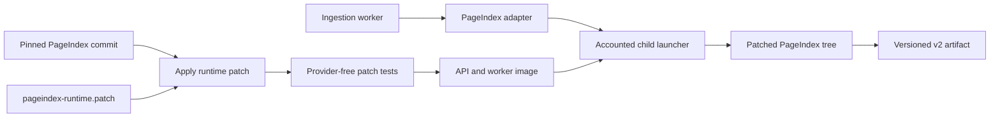

<!-- Content type: Conceptual -->
<!-- Content plan: Goal: explain why Vectorless RAG carries a PageIndex runtime patch, what each patch area changes, and how maintainers preserve artifact identity and verify the result. Audience: maintainers and researchers evaluating the ingestion architecture. Content: rationale, runtime boundary, defect classes, observed evidence, file inventory, versioning, verification, and scope. Open questions: which hunks can be retired after a future upstream revision is evaluated. -->

# Why Vectorless RAG patches PageIndex

Vectorless RAG uses [PageIndex](https://github.com/VectifyAI/PageIndex)’s document-tree algorithm, but the pinned upstream runtime did not meet the ingestion pipeline’s requirements for accounting, deterministic failure handling, structured output, document coverage, and artifact semantics. The repository therefore applies a reviewable patch to one pinned PageIndex commit during the API image build. This page explains why the patch exists, what it changes, and how the project proves which code produced each artifact.

## Why the upstream runtime was not sufficient

The ingestion pipeline needs more than a plausible document tree. It must produce a reproducible artifact, charge every provider call to the correct operation, stop within configured limits, and report failures without exposing document content. The pinned upstream revision did not satisfy those requirements in five areas:

- **Provider control**: internal model calls bypassed the application’s usage ledger, budget reservations, tracing, timeout, retry, and failure-classification systems
- **Structured output**: calls that expected JSON did not validate JSON at the model boundary, and the fallback parser could corrupt valid text
- **Document robustness**: grouping, table of contents (ToC) handling, page repair, and recursive subdivision rejected or damaged valid academic papers
- **Artifact semantics**: upstream emitted one summary per node, while the v2 artifact requires separate direct and subtree summaries
- **Dependency maintenance**: the runtime depended on vulnerable, unmaintained `PyPDF2` and crashed when a PDF page had no extractable text

These defects occur inside PageIndex’s batching and tree-construction logic. An adapter around the final result cannot recover a section that PageIndex discarded, reverse a corrupt page range, or account for a model call that already happened. Post-processing would also hide the cause by rewriting a damaged tree after the provider spend. The fixes therefore live at the PageIndex call sites and algorithms that own the behavior.

Replacing PageIndex with another indexing engine would answer a different research question. The project instead keeps the upstream algorithm, pins its source, and changes only the runtime behavior required for safe, measurable ingestion.

## How the patched runtime enters the application

The build and ingestion paths keep upstream source, local modifications, and application policy separate:



`apps/api/scripts/install-pageindex.sh` clones PageIndex commit `190f8b378be58199ca993566a9214dba72089c54`, checks that the patch applies, and installs the patched tree at `/opt/pageindex`. The image build then runs `apps/api/scripts/test_pageindex_patch.py` against that exact checkout.

At ingestion time, `PageIndexAdapter` starts `vectorless_rag.run_pageindex` as an isolated child process. The launcher establishes application usage ownership before it runs the upstream CLI. The patched PageIndex utilities import the application’s model-call functions through that boundary.

## What the patch changes

The current `+vr7` patch changes five upstream files:

| Requirement | Upstream behavior | Patched behavior |
| --- | --- | --- |
| Accounted model calls | Private retry helpers called the provider and returned an empty string after terminal failure | Application runtime records usage, reserves cost, traces calls, bounds retries, and raises classified failures |
| Valid structured output | JSON consumers accepted unvalidated text and used a corrupting cleanup parser | Eleven structured call sites require JSON and classify malformed responses |
| Bounded document batches | Groups overlapped and could exceed the model’s token limit | Groups are disjoint, enforce the cap, and split oversized pages without losing page markers |
| Stable continuation trees | Later batches blindly appended repeated or out-of-order ToC entries | Continuations deduplicate exact repeats and sort entries into safe page order |
| Academic-paper coverage | A valid ToC ending in the first half of a paper scored zero | Every placed title is checked regardless of document coverage |
| Recoverable subdivision | A failed optional subdivision discarded the whole document | The verified parent node remains when subdivision fails |
| Correct ToC routing | A detected ToC without printed page numbers was discarded | The runtime preserves its structure and locates pages through the pageless path |
| Safe page repair | Missing pages produced empty windows, `KeyError`, or malformed-response crashes | Search bounds use real page limits and validate every repair response |
| Bounded recursion | Large-node subdivision could recurse without a cap and delete valid children | Recursion stops at depth 16 and retains children within the original node range |
| Artifact summaries | Each node received one independent summary | Children summarize first, then each node receives direct and subtree summaries |
| Maintained PDF parsing | `PyPDF2` remained vulnerable and blank pages could yield `None` | `pypdf` replaces `PyPDF2`, and blank pages produce empty text |
| Deterministic startup | LiteLLM could fetch its model-cost map during import | The child uses LiteLLM’s bundled cost map |

## Route model calls through application policy

The patch removes upstream `llm_completion`, `llm_acompletion`, and `extract_json` implementations from `pageindex/utils.py`. It imports their replacements from `vectorless_rag.pageindex_runtime`.

The upstream helpers retried every exception up to 10 times and returned `""` after terminal failure. That behavior converted provider failures into malformed trees. It also bypassed durable cost and attempt accounting.

The application runtime adds these controls:

- A usage-ledger row and cost reservation for every call
- Langfuse generation traces linked to the ingestion attempt
- Configured output-token and timeout limits
- Bounded retries with retryable and terminal failure classes
- Sanitized diagnostics such as `pageindex_llm_retry_exhausted`, `pageindex_content_filter`, `pageindex_empty_response`, and `pageindex_invalid_json`

The replacement JSON parser also avoids two corrupting transformations in upstream code. Upstream replaced every `None` substring with `null` and removed every newline before parsing. Those substitutions could change titles or summaries that contained the same characters.

Eleven PageIndex functions now pass `expect_json=True` when their result must be an object:

- `check_title_appearance`
- `check_title_appearance_in_start`
- `toc_detector_single_page`
- `check_if_toc_extraction_is_complete`
- `check_if_toc_transformation_is_complete`
- `detect_page_index`
- `toc_index_extractor`
- `add_page_number_to_toc`
- `generate_toc_continue`
- `generate_toc_init`
- `single_toc_item_index_fixer`

Malformed structured output now fails at the provider boundary instead of reaching later tree code as a partial dictionary.

## Keep document batches within model limits

`page_list_to_group_text` prepares token-bounded text groups for ToC generation. The patch rewrites this function because upstream grouping violated the boundary it was meant to enforce.

The patched grouping algorithm makes four guarantees:

- **No overlap**: a page appears in one group, so continuation batches do not regenerate the previous group’s final sections
- **Hard token cap**: every emitted group remains at or below `max_tokens`
- **Marker preservation**: oversized pages split by binary search, and each chunk retains its `<physical_index_N>` markers
- **No empty prompts**: an empty result raises before a provider call

A final-result adapter cannot implement these guarantees because grouping happens before PageIndex sends prompts to the model.

## Merge continuation results without corrupting ranges

Long documents use `generate_toc_init` for the first group and `generate_toc_continue` for later groups. A continuation may repeat a section from its context with the original page, a shifted page, or a page that validation changed to `None`. Upstream appended every entry.

The patch adds `merge_continuation_entries`. It removes exact repeats using normalized `(structure, title, physical_index)` keys, retains nonidentical entries, and applies a stable page-order sort with `None` entries last.

Ordering matters because downstream `post_processing` derives each section’s end from the next section’s start. An out-of-order duplicate can create a reversed page range and invalidate the document.

Patch `+vr4` initially rejected conflicting repeats. Document `2103.05633` showed why that rule was too strict: a continuation can legitimately repeat a section whose page marker is absent from the later chunk. Patch `+vr5` adopted the current deduplicate-and-sort behavior.

## Preserve valid academic-paper structures

Several upstream assumptions treated recoverable academic-paper layouts as terminal failures. The patch changes those cases without relaxing title-level validation.

### Verify front-loaded tables of contents

Upstream `verify_toc` returned zero without checking any title when the last placed entry occurred in the document’s first half. References and appendices make that layout common in academic papers.

Six of the tracked corpus’s 104 documents failed this gate. Document `2408.00724` had 22 pages and 11 correctly placed entries ending on page 10, followed by acknowledgments and a bibliography. The patch rejects only a ToC where no entry has a page. It still verifies every placed title and preserves the existing accuracy thresholds.

### Keep verified nodes when optional subdivision fails

`process_large_node_recursively` subdivides a verified node so later retrieval receives finer sections. Upstream propagated a nested subdivision failure and discarded the entire document.

Document `2305.16264` demonstrated this failure on a verified 50-page tree. The patch keeps the original node when nested processing fails. The result still has a valid range and summary, even though it has less structural detail.

### Route each ToC shape to the matching algorithm

Upstream used the ToC path only when the detected ToC included printed page numbers. It discarded a real pageless ToC and regenerated structure from document text.

The patch sends that case to `process_toc_no_page_numbers`, which preserves the detected headings and searches for their pages. If a numbered ToC yields no reliable printed-to-physical offset, `process_toc_with_page_numbers` falls back to the same path instead of passing `None` into offset arithmetic.

### Repair missing page numbers safely

`process_none_page_numbers` asks the model to place headings that lack a physical page. The patch:

- Treats an explicit `physical_index=None` as missing
- Uses the document’s real first and last page as default search bounds
- Skips provider calls for empty search windows
- Removes optional `page` fields without raising `KeyError`
- Validates response shape before reading the result

These checks turn malformed repair data into controlled behavior instead of secondary exceptions.

## Retain large-node structure

The patch repairs four defects in recursive subdivision:

- **Recursion cap**: subdivision stops at depth 16
- **Correct trigger**: the true inclusive page count or token count can trigger subdivision
- **Range filtering**: sections outside the parent’s original range are discarded
- **Child retention**: filtering compares children with the parent’s original end, not the rewound end used to insert the first subsection

The last defect silently removed every child after a large node was subdivided. A later edge case also removed a first subsection that began on the parent’s first page. The provider-free regression suite covers both range semantics.

After the final repair, rebuilding `2103.05633` increased its tree from 37 nodes at depth 3 to 45 nodes at depth 4. The additional nodes are sections the old filter deleted.

## Build direct and subtree summaries

The v2 artifact distinguishes a summary generated from node text alone from one explicitly composed with descendant summaries. Upstream summarized every node independently and emitted one `summary`. Its tree builder temporarily added node text for summarization, then removed it when `if_add_node_text=no`.

The patched summarizer walks the tree from children to parents. It writes:

- **`direct_summary`**: a summary prompted with the node’s page-range text and no child-summary context
- **`subtree_summary`**: a summary prompted with the same text plus child summaries
- **`summary`**: the subtree summary retained for PageIndex compatibility

The patched helper also tolerates a missing `text` field, which makes it safe outside the tree builder’s temporary-text lifecycle. Bottom-up order is part of artifact semantics because parent summaries cannot incorporate descendant summaries until child summaries exist.

## Use a maintained PDF parser

Patch `+vr7` replaces `PyPDF2` with [`pypdf 6.14.2`](https://pypdf.readthedocs.io/en/latest/meta/history.html) in `pageindex/client.py`, `pageindex/retrieve.py`, `pageindex/utils.py`, and `requirements.txt`. This removes the vulnerable direct dependency from both the application and vendored runtime.

`pypdf` can return `None` for a page without extractable text. The patch normalizes that result to `""` in every PageIndex extraction path, so blank pages remain valid pages.

Artifact metadata records the parser that produced page evidence:

- Multi-page PageIndex artifacts record `pypdf` and its installed version
- The application’s single-page shortcut records `pymupdf` and its installed version

Parser identity contributes to the artifact configuration hash.

## Keep child startup deterministic

The patch sets `LITELLM_LOCAL_MODEL_COST_MAP=True` before importing LiteLLM. The child process therefore reads the bundled model-cost table instead of fetching a remote copy at import time.

This setting does not replace application cost configuration. It removes an unrelated network dependency from child startup.

## Why the project carries a patch instead of a fork

A source patch keeps the local contract narrow and auditable. It also preserves a direct comparison with the pinned upstream implementation.

The current approach has four properties:

- **Exact baseline**: every image starts from one immutable upstream commit
- **Visible divergence**: `apps/api/patches/pageindex-runtime.patch` contains the complete source difference
- **Early drift detection**: `git apply --check` fails before the image can include a partial patch
- **Independent retirement**: a future upstream revision can replace individual hunks after their behavior and artifact impact are tested

A long-lived fork would duplicate release, dependency, and merge maintenance without removing the need to pin and verify the exact code used in an experiment.

## How patch identity prevents stale artifact reuse

Three values bind a built artifact to the runtime that produced it:

- **`pageindex_version`**: `190f8b378be58199ca993566a9214dba72089c54+vr7` combines the upstream commit with the local patch revision
- **`patch_sha256`**: `PageIndexAdapter` hashes the complete patch file at ingestion time
- **`configuration_hash` and `recipe_hash`**: both include the version, patch digest, model configuration, parser identity, and other result-affecting options

Any behavior change requires a `+vrN` bump. The patch digest changes even if a maintainer forgets the bump, but the explicit suffix remains required because operators and reports use it as the readable runtime version.

An artifact built under a different patch cannot satisfy the current recipe key. Re-indexing creates a new immutable artifact and activation record instead of overwriting the old result.

## File inventory

The patch touches these upstream surfaces:

| File | Patched responsibility |
| --- | --- |
| `pageindex/client.py` | Use `pypdf` when PageIndex stores per-page content |
| `pageindex/page_index.py` | Validate structured calls, group pages, merge continuations, route ToCs, repair page indices, verify coverage, and subdivide nodes |
| `pageindex/retrieve.py` | Use `pypdf` when retrieval reads source pages |
| `pageindex/utils.py` | Route model calls through the application, parse JSON, use `pypdf`, normalize blank pages, and build bottom-up summaries |
| `requirements.txt` | Replace `PyPDF2` with the pinned `pypdf` version |

The application-side integration lives in:

| File | Responsibility |
| --- | --- |
| `apps/api/scripts/install-pageindex.sh` | Clone the pinned commit and apply the patch |
| `apps/api/scripts/test_pageindex_patch.py` | Run provider-free tests against the patched checkout |
| `apps/api/src/vectorless_rag/pageindex_runtime.py` | Enforce provider accounting, tracing, limits, retries, and structured output |
| `apps/api/src/vectorless_rag/run_pageindex.py` | Establish usage ownership and emit sanitized failure reports |
| `apps/api/src/vectorless_rag/pageindex_adapter.py` | Launch the child, hash the patch, and build the versioned artifact |

## How to verify the patch

The API image build verifies both patch application and behavior. `install-pageindex.sh` fails if any hunk no longer matches the pinned commit. `test_pageindex_patch.py` then checks:

- Complete `PyPDF2` removal and blank-page parsing through `pypdf`
- Token-capped, marker-preserving page grouping
- Continuation deduplication, ordering, and `None` placement
- Retention of a first subsection on the parent’s first page
- Preservation of a verified node after subdivision failure
- Routing for a ToC without printed page numbers
- Title verification for a front-loaded ToC
- Rejection of a ToC with no placed entries
- Child-before-parent summary generation

Run the provider-free regression suite against a patched checkout:

```bash
uv --project apps/api run apps/api/scripts/test_pageindex_patch.py path_to_pageindex_checkout
```

Build the production API image to exercise the clone, patch, dependency installation, and regression checks together:

```bash
make docker-build-api
```

Passing unit tests without the image build is not sufficient. Only the image build proves that the patch still applies to a clean checkout of the pinned upstream commit.

## What the patch does not change

The patch does not own every PageIndex-related behavior:

- The pinned upstream revision already contains `_SYSTEM_HARDENING`, `_secure_doc_text`, `_validate_physical_indices`, and `<user_document>` prompt framing
- Retrieval routing and evidence-budget policy remain in the Vectorless RAG application
- The patch does not add optical character recognition (OCR) or support scanned PDFs
- Provider-backed ingestion still incurs model calls and cost
- The single-page shortcut remains application code and does not run the PageIndex tree builder

These boundaries matter during an upstream upgrade. A maintainer should not attribute upstream prompt hardening or application retrieval policy to the runtime patch.

## How to update or retire patch hunks

Treat an upstream PageIndex revision change as an artifact-producing behavior change:

1. Update the pinned commit in `apps/api/scripts/install-pageindex.sh`.
2. Compare every local hunk with the new upstream behavior.
3. Remove only the hunks whose required behavior upstream now implements and tests.
4. Regenerate `apps/api/patches/pageindex-runtime.patch` against a clean checkout.
5. Bump the `+vrN` suffix in `Settings.pageindex_version`.
6. Run the provider-free patch suite and the production API image build.
7. Rebuild affected documents into new immutable artifacts.

Do not edit the installed `/opt/pageindex` tree or patch a running container. Those changes bypass source review, patch hashing, and artifact identity.
